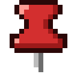

<div align="center">



# Pinned Advancement

**Pin the advancement you are working on and see what is still missing — right on your HUD.**


</div>

---

Client-side Fabric mod. Works in singleplayer and on servers, including datapack advancements such as
**BlazeandCave's Advancements Pack**. No server-side install needed, and it works with or without
the AdvancementInfo mod.

## ✨ Features

| Feature | Description |
|---|---|
| 📌 **Pin** | <kbd>Shift</kbd> + left click an advancement in the advancements menu. Shift + click again to unpin. The pinned advancement gets a blue frame. One pin per world / server, and it is unpinned automatically when completed. |
| 🪟 **On-screen window** | Styled like the vanilla advancement tooltip: title, description, *remaining X of Y*, percentage with a thin progress bar, and the missing requirements with item icons. |
| 🧩 **Missing requirements grid** | Right click an advancement in the menu to open an inventory-style grid of every missing requirement that has an item, with pages. Finished requirements disappear live. *Any of* requirements cycle through their options. |
| ⌨️ **Show / hide hotkey** | Any combination of <kbd>Ctrl</kbd> / <kbd>Shift</kbd> / <kbd>Alt</kbd> + key. Bound to the physical key, so it works with any keyboard layout. |
| ⚙️ **Settings** | Window width, scale, background opacity, number of requirement lines, grid size, detailed / compact mode, progress bar on/off, and window position — drag it anywhere, it snaps to edges and center. |

## 🎮 Controls

| Where | Action | What it does |
|---|---|---|
| Advancements menu | <kbd>Shift</kbd> + <kbd>LMB</kbd> | Pin / unpin |
| Advancements menu | <kbd>RMB</kbd> | Open the missing requirements grid |
| Grid | <kbd>‹</kbd> <kbd>›</kbd> or mouse wheel | Change page |
| In game | your hotkey (set in settings) | Show / hide the window |

## 📦 Installation

1. Install [Fabric Loader](https://fabricmc.net/use/) **0.19+** for Minecraft **26.3**.
2. Put [Fabric API](https://modrinth.com/mod/fabric-api) and `pinned-advancement-1.0.0.jar` into your `mods` folder.
3. *Optional:* [Mod Menu](https://modrinth.com/mod/modmenu) — to open the settings screen.

Settings and pins are stored in `config/pinnedadvancement.json`.

## 🔧 Building

Requires **JDK 25**.

```bash
./gradlew jar
```

The jar is written to `build/libs/pinned-advancement-1.0.0.jar`.
Mod Menu is a compile-only dependency from the [TerraformersMC maven](https://maven.terraformersmc.com/) and is not bundled.

## 🗂️ Project layout

```
src/main/java/dev/pinnedadv/
  PinnedAdvancement.java   entry point: HUD registration, clicks in the advancements menu, hotkey, pin state
  Config.java              settings and pins (config/pinnedadvancement.json)
  HudData.java             what the HUD / grid show (requirement rows grouped by requirement groups)
  Criteria.java            criterion name -> readable name + icon (exact and forgiving matching)
  PinnedHud.java           draws the on-screen window
  MissingScreen.java       missing requirements grid
  ConfigScreen.java        settings screen
  PositionScreen.java      drag the window to a position
  KeyNames.java            English key names by physical key
  ModMenuIntegration.java  Mod Menu entry point
  mixin/                   small hooks into the advancement screen, keyboard and advancement updates
src/main/resources/
  fabric.mod.json, pinnedadvancement.mixins.json
  assets/pinnedadvancement/  icon and translations (en_us, ru_ru)
```

## 📝 Notes

On a server the client only receives criterion *names*, not their conditions, so requirement names and icons are
guessed from those names. Most vanilla and BACAP criteria are recognised; ones without an item
(structures, biomes, kill methods) are shown as text in the on-screen window and are left out of the grid.

## 📄 License

[MIT](LICENSE) © lavaaashoff
